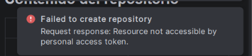

# Plataforma GNU/Linux para la Clínica San José de la Salud

Proyecto Integrador de **Sistemas Operativos** (UTP, ciclo 2026-II, sección 28957).
Implementación y administración de una plataforma GNU/Linux aplicada a un entorno
organizacional (organización ficticia del sector salud), más tres simuladores en Java
de algoritmos internos del sistema operativo.

**Docente:** Loo Parian, Luis Alberto

**Integrantes**

- Ramirez Flores, Jackeline Giomara
- Coello Flores, Milagros Guadalupe
- Cuenca Huaraca, Pierina de Alessandra
- Aguirre Ramirez, Michael Adriano
- Rivas Velasquez, Luizao Vicente
- Campos Huaytalla, Christian Leonel

## Contenido del repositorio

| Archivo | Descripción |
| --- | --- |
| `src/SimuladorCPU.java` | Planificación de CPU: FCFS y Round Robin (el quantum se ingresa por teclado). |
| `src/SimuladorPaginas.java` | Reemplazo de páginas: FIFO y LRU, con marcos en cada paso y total de fallos. |
| `src/SimuladorDisco.java` | Planificación de disco: FCFS y SSTF, con orden de atención y desplazamiento total. |
| `preparar_clinica.sh` | Crea los 3 grupos, los 6 usuarios, el árbol `/srv/clinica`, los archivos de prueba, propietarios y permisos. |
| `backup_clinica.sh` | Respalda `/srv/clinica` en el disco adicional y genera la suma SHA-256. |
| `verificar_backup.sh` | Comprueba un respaldo (SHA-256, lectura y restauración de prueba en un directorio temporal). |
| `auditoria_seguridad.sh` | Auditoría de solo lectura: grupos, sudo, contraseñas, permisos, SSH y volumen de respaldos. |

## Requisitos

- Ubuntu Server LTS en una máquina virtual de Oracle VirtualBox.
- Java 17 o superior (`sudo apt install openjdk-17-jdk`).
- Git (`sudo apt install git`).
- Para el respaldo: un disco virtual adicional con ext4 montado en `/srv/clinica/respaldos`.

## Obtener el código

```bash
git clone https://github.com/httpsmimite/SO.git
cd SO
```

## Ejecutar los simuladores

Se ejecutan directamente con Java 17 o superior, sin compilar antes:

```bash
cd src
java SimuladorCPU.java
java SimuladorPaginas.java
java SimuladorDisco.java
```

**SimuladorCPU.** Pide la cantidad de procesos (mínimo 5; `0` carga los datos de la clínica) y luego
el quantum de Round Robin. Imprime el diagrama de Gantt, espera y retorno de cada proceso, los
promedios y la comparación entre FCFS y Round Robin.

**SimuladorPaginas.** Pide la cadena de referencias separada por espacios y el número de marcos.
Ejemplo de la clínica: `7 0 1 2 0 3 0 4 2 3 0 3 2 1 2 0 1 7 0 1` con 3 marcos
(FIFO: 15 fallos; LRU: 12 fallos).

**SimuladorDisco.** Pide la posición inicial del cabezal (`-1` carga el escenario de la clínica:
cabezal en 53 y cola `98 183 37 122 14 124 65 67`) y, si se ingresa otra posición, la lista de
cilindros. Resultado del escenario: FCFS 640 cilindros; SSTF 236 cilindros.

## Preparar la plataforma Linux

```bash
sudo bash preparar_clinica.sh        # usuarios, grupos, directorios, archivos y permisos
sudo bash backup_clinica.sh          # respaldo en /srv/clinica/respaldos (requiere el volumen montado)
sudo bash verificar_backup.sh        # verifica el respaldo más reciente sin tocar los datos originales
sudo bash auditoria_seguridad.sh     # revisión de seguridad (solo consulta)
```

Las cuentas se crean sin contraseña (están bloqueadas). Para las pruebas se usa
`sudo -u <usuario> <comando>`; antes de un uso real se asignarían contraseñas individuales con `passwd`.

## Pruebas de acceso de ejemplo

```bash
sudo -u dra.mendoza ls /srv/clinica/laboratorio/resultados   # permitido
sudo -u ana.caja    ls /srv/clinica/laboratorio/resultados   # Permiso denegado
```

## Alcance

Prototipo académico reproducible. No incluye base de datos clínica real, alta disponibilidad,
cifrado de discos, autenticación centralizada ni firewall perimetral. Todos los datos son ficticios
y los pacientes se identifican solo con códigos (por ejemplo, `P-1001`).
